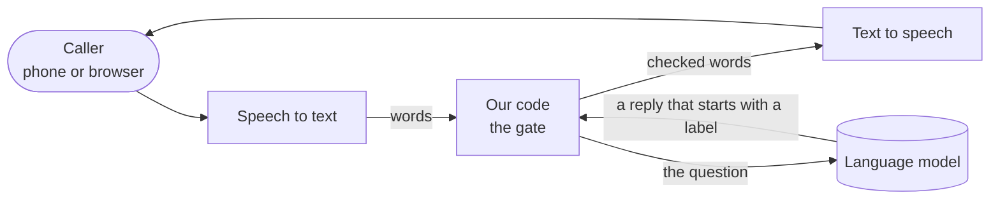

# Helpline: a phone agent that knows its limits

A voice agent for calls about late or missing money transfers. It answers from six help-centre articles and nothing else. Any other question gets a handoff to a human, and the call ends.

The articles are the ["Where is my money?" section](https://wise.com/help/topics/5bVKT0uQdBrDp6T62keyfz/sending-money) of the Wise help centre. This project is not affiliated with Wise.

https://github.com/user-attachments/assets/15be9e85-7ce9-419a-a9b5-f8b15d9851e7

Four minutes, with sound: one real call, then a question followed through every stage.

## How it works



The model must start every reply with a label, such as `[answer:02]` or `[handoff:out_of_scope]`. Our code reads the reply before anything is spoken, and keeps four rules:

1. **No label, no speech.** A reply without a valid label becomes a handoff.
2. **Only a cited answer is the model's own words.** Greeting, handoff and goodbye are fixed sentences. The model picks one. It does not write them.
3. **No new numbers.** A number in an answer must appear in the article it cites.
4. **Plain speech only.** No links, no markup, 60 words at most.

A rule that lives only in a prompt can be talked around. These four live in [`gate.py`](src/helpline/gate.py), in plain Python that the caller's words never reach.

| Part | Service |
| --- | --- |
| The call: phone number, browser audio | LiveKit |
| Speech to text, and hearing when the caller has finished | Deepgram Flux |
| The model | Gemini 3.5 Flash-Lite, with 3.1 Flash-Lite as backup |
| Text to speech | Deepgram Aura-2 |

## Run it

You need [uv](https://docs.astral.sh/uv/) and keys from three services with free tiers: [LiveKit Cloud](https://cloud.livekit.io), [Google AI Studio](https://aistudio.google.com/apikey) and [Deepgram](https://console.deepgram.com).

```bash
cp .env.example .env     # then fill in the five values
make test                # unit tests, no keys needed
make serve               # the agent; leave it running
make web                 # in a second terminal: http://localhost:8787
```

Open the page, press the circle and talk. It shows your words, the agent's reply, and which checks the reply passed. Talk over an answer and it stops.

Other ways in:

| Command | What it does |
| --- | --- |
| `make talk` | Talk to the agent in the terminal |
| `make call` | A scripted call with a computer voice as the caller (macOS) |
| `make eval`, `make holdout`, `make conversations` | The three test sets |

For a phone number, rent one in the LiveKit dashboard and run `lk sip dispatch create telephony/dispatch-rule.json`.

## Results

"Wrongly answered" is the mistake that matters: a question the articles do not cover, answered anyway. Three runs per question, measured 2026-11-23.

| Set | Questions | Wrongly answered | Wrongly handed off |
| --- | --- | --- | --- |
| Main. The prompt was tuned on it. | 78 | 0 of 150 | 0 of 84 |
| Held-out. Never used for tuning. | 30 | 0 of 60 | 1 of 30 |
| Whole calls, played in text | 16 | 16 pass | |

The one wrong handoff was the gate blocking an answer for a number its article does not contain. Raw output is in [`evals/results/`](evals/results/), and the full story, including two earlier failures and how they were fixed, is in [experiments](docs/05-experiments.md).

## When something breaks

| Failure | What the caller gets |
| --- | --- |
| The model is slow or returns an error | The backup model is asked |
| Both models fail | The handoff line, then the call ends |
| A reply breaks one of the four rules | The reply is blocked. Handoff line, call ends |
| Speech to text or the voice fails | The call is dropped at once, so nobody waits in silence |
| The caller says nothing | One "are you still there?", then goodbye |

## What does not work yet

- **It is slow.** About 2.5 seconds before it replies. People leave half a second. [Where the time goes](docs/04-architecture.md#where-the-time-goes), and how to get it to about one.
- **Answers are not graded word by word.** Tests check the action and the article cited. A second model as judge is designed, not built.
- **Few real phone calls.** Two. Almost all testing used a computer voice.
- **Not deployed.** It answers while the process runs on your machine.
- **No real human queue.** "Passing you to a human agent" is followed by the call ending.
- **English only.**

## Where things are

```
src/helpline/   lines.py  prompt.py  gate.py  brain.py  agent.py
tests/          unit tests of our own code: no model, no keys, run in seconds
evals/          questions sent to the real model, to measure how it behaves
web/            the site: talk to it, see how it works, review calls
docs/           plan, spec, design, architecture, experiments, decisions
```

| Doc | Answers |
| --- | --- |
| [Plan](docs/01-plan.md) | What problem, what we build, what we skip |
| [Spec](docs/02-spec.md) | What the agent does, as 20 rules |
| [Design](docs/03-design.md) | How it decides, and how we check it |
| [Architecture](docs/04-architecture.md) | The parts, one turn step by step, where the time goes |
| [Experiments](docs/05-experiments.md) | What we measured before deciding |
| [Decisions](docs/adr/) | Nine choices, what we compared, what we gave up |
