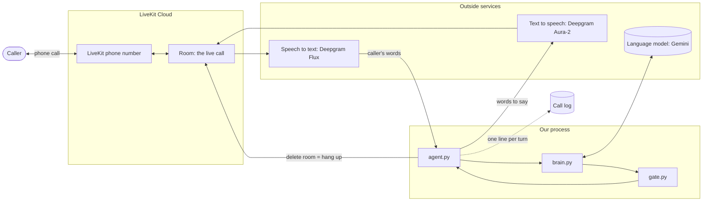

# Architecture

The parts, and how one call moves through them. The [design doc](03-design.md) covers how the agent decides.

## The parts



| Part | Job | What we use |
| --- | --- | --- |
| Phone number | Receives the call and puts the caller in a room | A LiveKit US number |
| Speech to text | Turns caller audio into words, and decides when they have finished | Deepgram Flux |
| Language model | Picks the action and writes the reply | Gemini 3.5 Flash-Lite, with 3.1 Flash-Lite as backup |
| Text to speech | Turns the reply into audio | Deepgram Aura-2 |
| `agent.py` | Runs the call: greeting, speaking, silence, hang-up, log | Our code |
| `brain.py` | Answers a few sentences by rule. Otherwise sends the rules, the articles and the call so far to the model | Our code |
| `gate.py` | Decides what may be spoken. Blocks anything unlabelled, uncited, or carrying a number the article does not have. | Our code |
| Framework | Moves audio between the parts, handles interruptions | LiveKit Agents |

Three accounts with free tiers cover all of it: LiveKit for the line, Deepgram for hearing and speaking, Google for the model. Each choice has a decision record in [`adr/`](adr/).

## One turn, step by step

1. The caller speaks. LiveKit streams the audio to speech to text.
2. Speech to text decides the caller has finished and hands our agent the words.
3. The session has no language model of its own. Our agent takes the turn from here.
4. `brain.py` first checks whether the sentence needs a model at all. (It may already have started: the agent begins this step as soon as a sentence looks finished, and keeps the result only if the final words match.) "Say that again", "agent", "hello" and "that's all" are matched by rule and skip the model.
5. Otherwise it sends the model the rules, the six articles, the call so far and the new words, and waits up to 5 seconds for the whole reply. If the model errors or is late, a backup model gets the same request. After 1.5 seconds of waiting the agent says "One moment", so the line is never silent for long.
6. `gate.py` reads the label and returns the exact words to say and whether to end the call.
7. For an answer or small talk, the agent speaks. The caller can interrupt.
8. For a handoff or goodbye, the agent speaks the fixed line, the caller cannot interrupt it, and once the audio has played the agent deletes the room. That drops the phone call.
9. The turn is written to the call log.

## Where the time goes

Measured with a computer voice as the caller, on a laptop in India, with timestamps taken at both ends of the call.

| Stage | Typical |
| --- | --- |
| Caller stops, to us holding their words | 0.7 s |
| Waiting for the model after that | 0.75 s |
| Voice starts | 0.25 s |
| Agent's audio reaches the caller's ear | 0.8 s |
| **Caller stops talking to agent starts** | **2.5 s** (2.0 to 2.9 over ten turns) |

That is too slow. People leave about half a second between turns, and start to say "hello?" after two.

The model itself takes about a second. We wait less than that because the agent starts asking as soon as a sentence looks finished, before the end-of-turn check is final. If the caller keeps talking, that early request is thrown away.

What we learned by measuring:

- **No single stage is the problem.** Four stages each take between a quarter of a second and a second and a half.
- **The model sends its whole reply in one piece**, on both models and on a paid key. First word and last word arrive together. So speaking the first sentence early would gain nothing.
- **The free model tier swings between one second and four**, and stops after 500 requests a day. A paid key is steady.
- **Distance to the speech service matters.** Moving from Deepgram's US region to its EU region, half as far from India, took a turn from 3.2 to 2.8 seconds.
- **Starting the model early helps.** Asking on a finished-looking sentence, instead of waiting for the end-of-turn check, took the same ten-question call from 2.8 to 2.5 seconds.
- **Did not help:** turning off the model's thinking step on 3.1 Flash-Lite, and a more eager end-of-turn setting.
- **Made it worse:** asking the model twice and taking the first reply. On the free key it used the daily allowance twice as fast and ended a test call.

What would cut it, biggest first:

1. **Run the agent in the same region as the speech services and the caller.** Hearing and the network each lose a few tenths to distance.
2. **A model host built for speed.** Around 0.3 seconds a reply instead of one. It has to pass the scope tests first; the fast one we tried did not.

With both, a turn should take a little over a second. That is an estimate.

Speech-to-speech models, such as OpenAI's Realtime API and Gemini Live, reply in under a second. They speak as they think, so there is no text for code to check before the caller hears it. That gives up the gate, and for questions about money we would rather be a second slower. [ADR 0001](adr/0001-text-pipeline-over-speech-to-speech.md) has the full comparison.

## Interruptions

The caller can talk over an answer. Any voice lasting 0.3 seconds stops the agent. In a timed run it went quiet 0.8 seconds after the caller started, then answered the new question.

We first used LiveKit's smarter detector, which tries to tell a real interruption from a cough or "mm-hm". In a real browser call, with the agent's own voice coming out of laptop speakers, it missed the interruption entirely. The plain rule has not.

The fixed handoff and goodbye lines are the exception: once the agent has decided to end the call, they play to the end.

## The call log

One JSON line per turn, in `logs/calls.jsonl`. This is the audit trail.

```json
{
  "time": "2026-11-22T06:14:51+0530",
  "call_id": "call-_+15550100_x7Qm",
  "turn": 2,
  "heard": "How do I get a refund?",
  "model_reply": "[handoff:out_of_scope]",
  "action": "handoff",
  "detail": "out_of_scope",
  "said": "That's something a member of our team needs to help you with…",
  "model_ms": 693,
  "model": "gemini-3.5-flash-lite",
  "prompt_version": "e8692715c94f"
}
```

`model_reply` keeps exactly what the model wrote, including replies the gate blocked. `prompt_version` is a hash of the prompt and the articles, so any decision can be tied to the exact text the model saw. A separate line records how long the voice took to start.

For a call from a phone, the room name LiveKit generates contains the caller's number. The agent masks it before anything is logged. Transcripts can still hold personal details a caller volunteers, and would need redaction before this ran at real volume.

## Ways to run it

| Mode | Command | Use it for |
| --- | --- | --- |
| Text | `make eval` | The test questions. No audio. |
| Terminal | `make talk` | Talking to it with this computer's microphone |
| Website | `make serve` and `make web` | Talking to it from a browser, and watching each decision |
| Phone | `make serve`, then dial the number | Real calls |
| Test caller | `make call` | A scripted call with real audio, no phone |

All of them need the keys in `.env`. In phone mode the agent connects out to LiveKit, so it needs no public address. It answers for as long as the process runs.

## When something fails

| Failure | Behaviour |
| --- | --- |
| Model errors or takes over 5 seconds | The backup model is asked |
| Backup fails too | Handoff line, hang up, logged as `model_error` |
| Label missing or malformed, or an answer fails the number check | Handoff line, hang up, logged with the reason |
| Speech to text or text to speech fails | The call is dropped at once, and the log says why. We cannot speak, so we do not leave the caller in silence. Tested by breaking the voice key. |
| Caller hangs up | The session closes. |
| Caller silent for 10 seconds | "Are you still there?" Then goodbye and hang up. |

## What would change at volume

This runs one call per process on one machine. That is enough for now. For thousands of calls at once, the shape stays and these parts change:

- **Processes.** LiveKit already starts one worker process per call. At volume the workers run on several machines.
- **Regions.** Run close to the carrier and the model provider. Network distance is the easiest latency to remove.
- **Logs.** From a file to a store with retention rules, redaction and search. Every call gets scored, not a sample.
- **Fallbacks.** A second provider for each of speech to text, model, and text to speech.
- **Handoff.** A real transfer to a queue. The call log already holds what the human needs: the transcript, the handoff reason, and the last question. It gets passed along so the caller does not repeat themselves.
- **Knowledge.** When the articles grow past what fits comfortably in a prompt, add search, and re-run the scope evals before trusting it. [ADR 0003](adr/0003-whole-faq-in-the-prompt.md) says where that line is.
- **Account lookups.** A tool the model can call after the caller is verified. This is the biggest change, because the agent stops being read-only.
